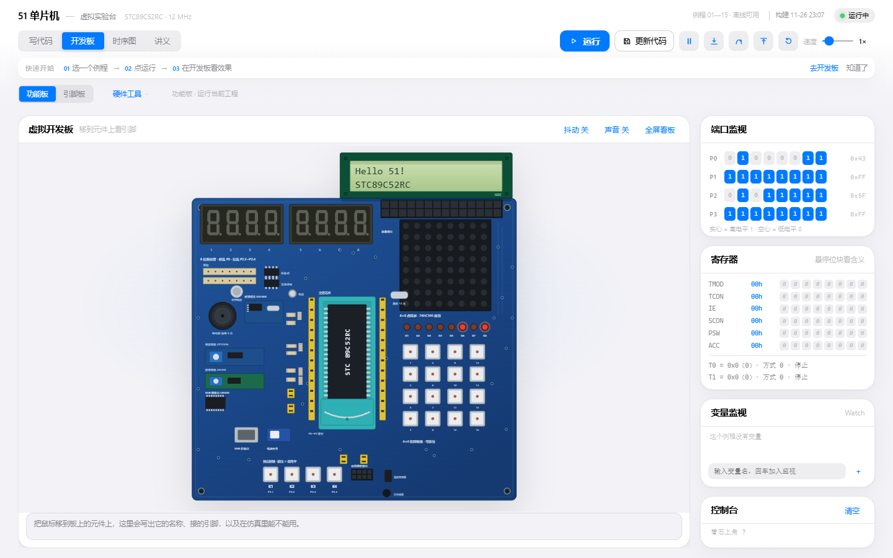
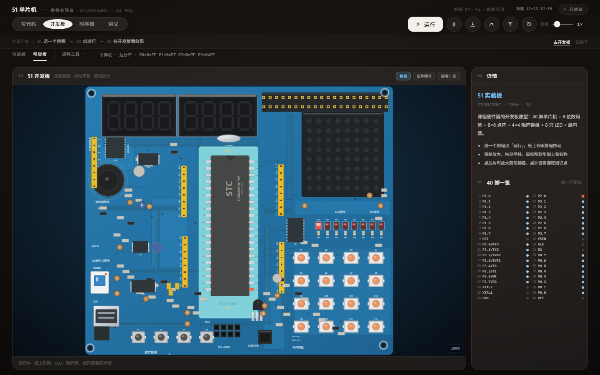
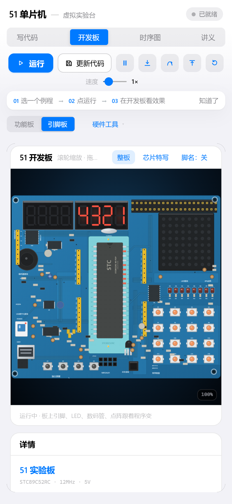

# 51 单片机 · 虚拟实验台

**在浏览器里写 C51、跑开发板、量时序——不用买板子，也不用装 Keil。**

纯前端 · 零运行时依赖 · 离线可用 · 构建产物是单个 HTML

[](https://github.com/syh-student/51-mcu-virtual-lab/actions/workflows/ci.yml)
[](LICENSE)
[](https://syh-student.github.io/51-mcu-virtual-lab/)
[](src/examples.js)

**https://syh-student.github.io/51-mcu-virtual-lab/**



## 这是什么

一个把"写代码 → 编译 → 看现象 → 量时序"压进同一个网页的 51 单片机学习工具。

- **不用等硬件**：没有开发板、没有 USB 线、没有烧录器，双击一个 HTML 就能开始。
- **不用装工具链**：自带 C51 教学级解释器，编译和运行都在本地浏览器里完成，不联网。
- **看得见波形**：每个引脚的电平变化都被记录下来，可以像逻辑分析仪那样量时间差。

它不试图替代 Keil + 真板子，目标是**把入门的反馈回路缩短到一秒**：改一行，按 F5，立刻看到哪盏灯亮了、数码管显示什么、串口吐出了什么。

## 界面

| 写代码：编辑器 + 工程树 + 编译输出 | 时序图：引脚波形与光标测量 |
| --- | --- |
|  |  |

| 引脚板：40 脚实物排布 | 硬件实验室：电路实验台 |
| --- | --- |
|  |  |

手机上也能用（开发板页会自适应竖屏）：



> 以上截图由 `npm run shots` 用真实浏览器渲染生成，改界面后可以一键重拍，不存在"图文不一致"。

## 快速开始

**在线**：打开 <https://syh-student.github.io/51-mcu-virtual-lab/>。

**本地**：下载仓库，双击 `index.html`，用 Edge / Chrome 打开。无需联网、无需服务器。

```bash
# 从源码构建（改 src/ 之后必须重新生成根目录的 index.html）
python build.py

# 三套回归，纯 Node，不依赖浏览器
npm test
```

> 「连接电脑上的文件夹（磁盘工程）」需要 File System Access API，只有 Edge / Chrome 支持；其余功能所有现代浏览器可用。

## 功能

### 写代码

- **C51 教学级解释器**：变量、数组、函数、`static`、`typedef`、`struct`（含结构体数组与嵌套）、`if/while/for/do/switch`、内置 SFR 名。
- **Keil 式多文件工程**：Project → Target → Source Group，逐文件编译后链接；`static` 按文件隔离，`extern` 跨文件引用；工程树支持多级文件夹与拖拽换组。
- **Keil 工程导入**：开工程支持 `.uvproj / .uvprojx`：选中工程文件后，再选它所在目录，按 Keil 里的路径把 `.c/.h` 读进来；也可以直接用「打开文件夹」读写原工程。
- **江协库风格例题**：工程树底部「江协库」一键载入多文件示例，包含 `disled` / `display` / `keyscan`，按 `user` / `library` 分组；也能直接编译原始江协库源码（`unsigned short int` 已支持）。
- **IDE 手感**：语法高亮、自动缩进、括号配对、自动补全、`Ctrl+/` 注释、断点、单步（进入/越过/跳出）、调用栈、查找替换、F12 跳转到定义。
- **结构化编译输出**：级别 / 文件 / 行号 / 说明，可筛选、点击跳转；不是一坨日志。
- **工程可带走**：存成 `.c51proj.json` 换台电脑继续改；也能把当前代码压成分享链接。

### 开发板

- **功能板**：LED ×8、独立按键 K1~K4、4×4 矩阵键盘、数码管、LCD1602、蜂鸣器，1:1 矢量绘制。
- **引脚板**：按 40 脚实物排布，同一份代码换个板面继续跑。
- **时序真实**：12 MHz 晶振（机器周期 1 μs）、定时器 0/1、外部中断 0/1、串口收发。

### 时序图

- 记录一次运行的完整引脚波形，下次运行自动清空。
- 全程 / 200 ms / 1 s / 5 s 时间窗口，1×/4×/16× 横向缩放。
- 光标 A/B 量 Δt、悬停读端口值、导出 PNG / CSV。

### 硬件实验室（`hardware.html`）

- **电路实验台**：元件库、拖拽连线、撤销重做、网格吸附、滚轮缩放、画布自动保存。
- **画板模拟**：原理图 ↔ PCB 双视图、网络表、DRC 检查。
- **参数计算器**：LED 限流、色环 / 贴片读数、分压、RC、三极管偏置、功耗校验。
- **自测练习**：硬件篇章节选择题，答完给分和解析。

## 快捷键

| 按键 | 功能 | 按键 | 功能 |
| --- | --- | --- | --- |
| `F5` / `Ctrl+Enter` | 运行 | `F9` | 切换断点 |
| `F10` / `F11` / `Shift+F11` | 单步越过 / 进入 / 跳出 | `F12` / `Ctrl+点击` | 跳转到定义 |
| `Ctrl+F` | 查找替换 | `Ctrl+Z` / `Ctrl+Y` | 撤销 / 重做 |
| `Ctrl+/` | 整行注释切换 | `Esc` | 退出全屏看板 |

## 项目结构

```text
.
├── index.html            # 构建产物：GitHub Pages 入口，不要手改
├── hardware.html         # 构建产物：硬件实验室（独立页面，iframe 加载）
├── src/
│   ├── index.template.html   # 页面骨架，构建时填入 CSS / JS
│   ├── style.css
│   ├── vm.js                 # C51 预处理 / 词法 / 语法 / 虚拟机 / 工程级链接
│   ├── hw.js                 # 虚拟硬件模型（LED、数码管、按键、LCD、串口）
│   ├── examples.js           # 15 个配套例程（代码 + 知识点 + 练习）
│   ├── app.js                # 界面、工程树、编辑器、时序图、分享
│   └── hardware.html         # 硬件实验室（单文件）
├── build.py              # 把 src/ 拼成两个 HTML
├── test.js               # 虚拟机与硬件模型回归（60 条）
├── test-examples.js      # 所有例程编译 + 跑一段，防回归
├── test-ui.js            # 极简 DOM 桩跑界面代码（树、编辑器、事件）
├── tools/
│   ├── shots.js          # 用 puppeteer 生成 README 截图
│   └── verify.js         # 真实浏览器里验证交互（F12、文件夹等）
└── docs/screenshots/     # 截图产物
```

**构建流程**：

```text
src/*.js + style.css + index.template.html
                  │
           python build.py
                  │
        ┌─────────┴─────────┐
   index.html          hardware.html
  （单文件 约 380 KB）  （原样复制）
```

没有打包器、没有 npm 运行时依赖——拼字符串就是构建，改完刷新就能看到。

## 测试

```bash
npm test          # 三套全跑，约 1 秒
npm run lint      # ESLint，源码零告警
```

| 套件 | 覆盖什么 | 规模 |
| --- | --- | --- |
| `test.js` | 端口位操作、数码管扫描、按键消抖、LCD、定时器与中断、串口、多文件链接、宏与条件编译、struct | 58 条断言 |
| `test-examples.js` | 把 15 个例程全部编译并推进虚拟时间，对比端口 / 数码管 / LCD 状态 | 15 个例程 |
| `test-ui.js` | 用极简 DOM 桩跑真实界面代码：工程树、文件夹、新建文件、断点、自动缩进、Ctrl+/ 等 | 40+ 条断言 |

CI 在每次 push / PR 时跑：构建 → 校验产物无残留占位符 → lint → 三套回归（见 `.github/workflows/ci.yml`）。

想在真实浏览器里验证：`npm install && npm run verify`（会下载一次 Chrome）。

## 已知边界

这是**教学级仿真**，不是指令级模拟器。以下暂时不支持，写了会在编译时给中文提示：

- 不生成 `.hex`，也不包含 STC-ISP 下载 / 真板烧写环节；导出 zip 只含源码，需在 Keil 里新建工程后把这些文件加入
- 指针与函数指针、联合体（`union`）、位域
- I2C / 单总线 / ADC 等协议级外设
- 定时器模式 0、8×8 点阵、DS1302
- `#if` 里不能用宏的数值参与比较（`#ifdef` / `#if 0` 等正常）

引脚板只覆盖 LED、数码管、按键、矩阵键盘和蜂鸣器；LCD、串口、定时器 / 中断与多文件工程请用功能板，切过去时页面会给出提示。

## 路线图

- [ ] 指针与数组下标的更完整支持（含函数指针）
- [ ] I2C / DS1302 / 单总线时序外设
- [ ] 引脚板补齐 LCD 与串口
- [ ] 例程进度与练习判分的本地记录
- [ ] 移动端编辑器输入体验（软键盘、手势）

欢迎在 [Issues](https://github.com/syh-student/51-mcu-virtual-lab/issues) 里提需求；参与方式见 [CONTRIBUTING.md](CONTRIBUTING.md)。

## 来源与版权

本项目是个人学习笔记性质的整理与工具实现，**代码、虚拟硬件模型与例程均为按知识点独立实现**，未复制任何课程原文、讲义或源码，仅供学习交流，非商业用途。以 [MIT](LICENSE) 协议开源。

知识点顺序参考（版权归原作者所有）：

- 第一篇（软件开发）：**江协科技《51 单片机入门教程 · 2020 版》**
- 第二篇（硬件开发）：**Expert 电子实验室 · 立创 EDA 专业版课程**

配套讲义 docx 因版权原因**未随本仓库公开**，如需学习请通过原作者渠道获取。如原作者认为相关内容不当，请联系删除。
