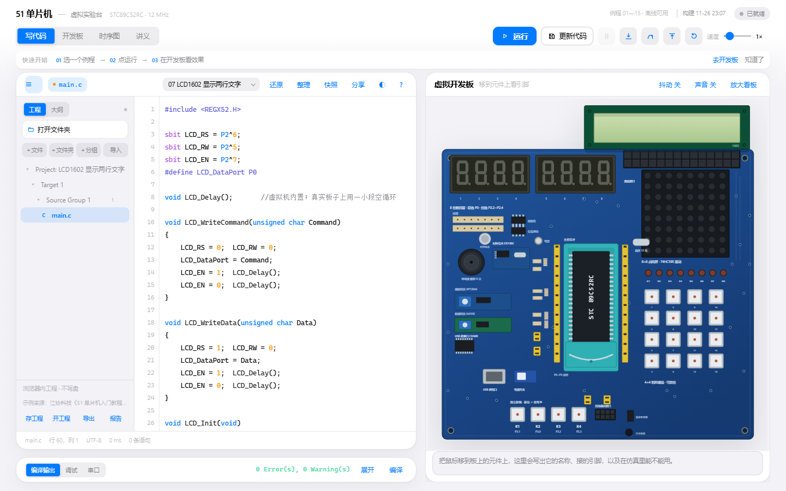
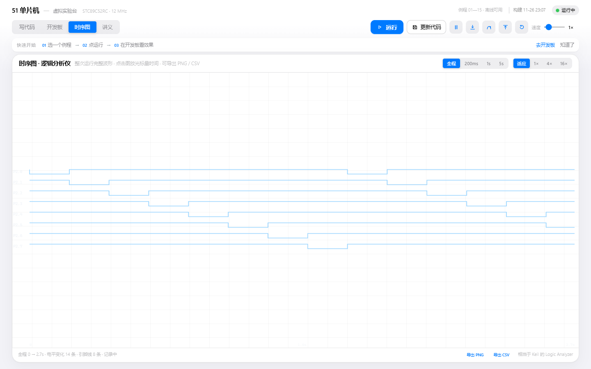
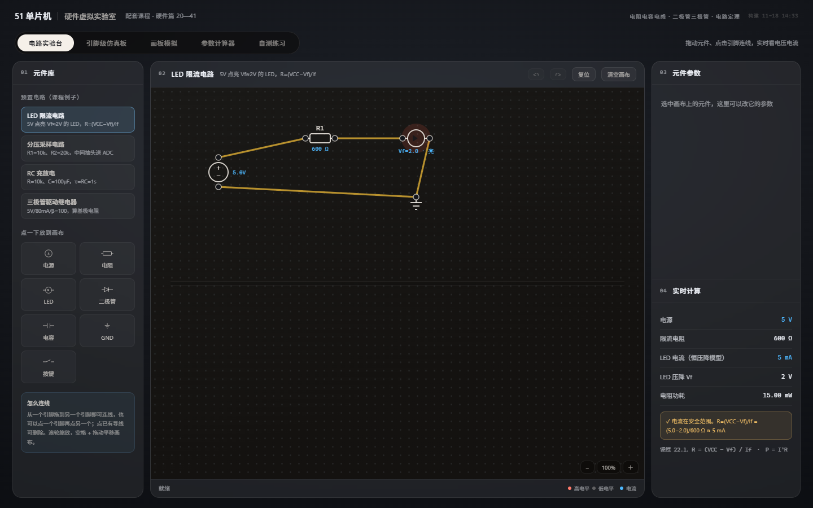
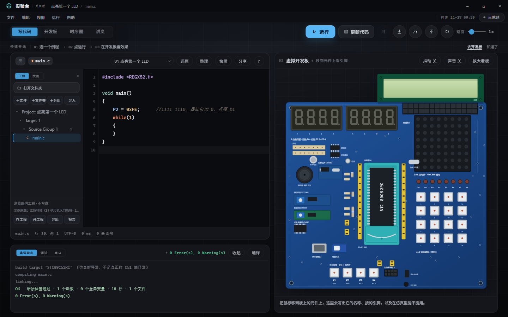
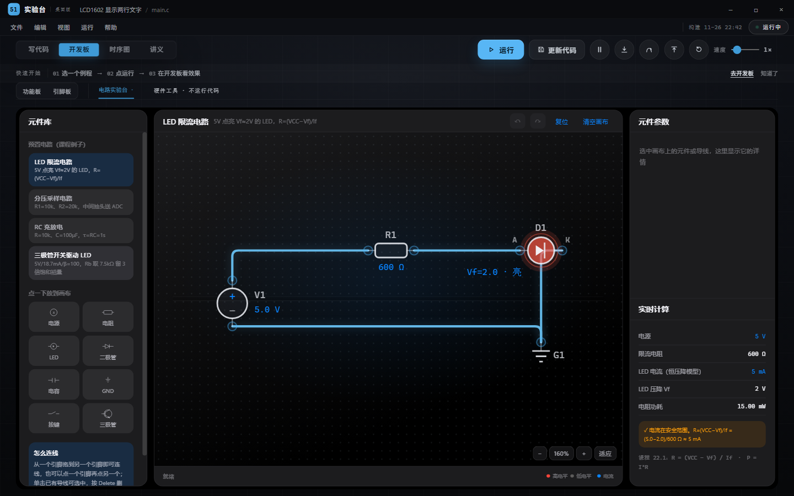
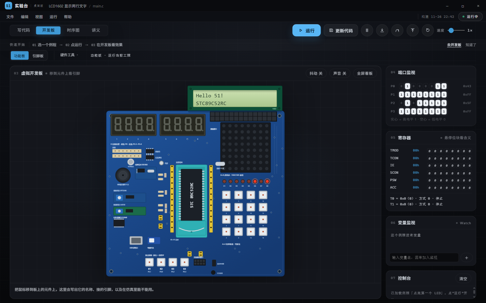

# 51 单片机 · 虚拟实验台

**在浏览器里写 C51、跑开发板、量时序——不用买板子，也不用装 Keil。**

纯前端内核 · 零运行时依赖 · 离线可用 · 可选 Windows 桌面版（Electron）

[](https://github.com/syh-student/51-mcu-virtual-lab/actions/workflows/ci.yml)
[](LICENSE)
[](https://syh-student.github.io/51-mcu-virtual-lab/)
[](src/examples.js)

**https://syh-student.github.io/51-mcu-virtual-lab/**


## 这是什么

一个把"写代码 → 编译 → 看现象 → 量时序"压进同一个网页的 51 单片机学习工具。

- **不用等硬件**：没有开发板、没有 USB 线、没有烧录器，双击一个 HTML 就能开始。
- **不用装工具链**：自带 C51 教学级解释器，编译和运行都在本地浏览器里完成，不联网。
- **看得见波形**：每个引脚的电平变化都被记录下来，可以像逻辑分析仪那样量时间差。

它不试图替代 Keil + 真板子，目标是**把入门的反馈回路缩短到一秒**：改一行，按 F5，立刻看到哪盏灯亮了、数码管显示什么、串口吐出了什么。

## 界面

| 写代码：编辑器 + 工程树 + 编译输出 | 时序图：引脚波形与光标测量 |
| --- | --- |
|  |  |

| 引脚板：40 脚实物排布 | 硬件实验室：电路实验台 |
| --- | --- |
|  |  |

手机上也能用（开发板页会自适应竖屏）：


> 以上截图由 `npm run shots` 用真实浏览器渲染生成，改界面后可以一键重拍，不存在"图文不一致"；桌面版三张是 1440×900 的 Electron 窗口实拍。

桌面版和网页共用同一份页面内核，但窗口外壳已经改成软件式结构：自绘标题栏、菜单栏和窗口控制，不再是浏览器的网页页头。桌面窗口直接用线上那套 **深夜仪表台深色皮肤**：`#0a0b0e` 底、`#14161c` 卡片、发丝边框、`#3f9ad6` 柔和蓝强调色，和网页端观感一致；桌面固定深色，不提供浅色切换。分段控件的选中块是方块滑块（4px 圆角），两端同一套形状，颜色跟随各自主色。IDE 的功能密度、工程树和快捷键都保留，没有照搬手机的单列布局。

| 桌面版 · 写代码 | 桌面版 · 硬件实验台 |
| --- | --- |
|  |  |

| 桌面版 · 原生开发板 |
| --- |
|  |

## 桌面版（Windows）

如果不想依赖浏览器、或者想要一个独立的桌面窗口，可以直接用打包好的 Electron 版。

| 版本 | 文件 | 特点 |
| --- | --- | --- |
| 免安装绿色版 | `dist/51Lab-1.2.9-win-x64.exe` | 双击即用，不写注册表；首次启动会解压到临时目录，约 106 MB |
| 安装版 | `dist/51Lab-Setup-1.2.9-x64.exe` | 可选安装目录、创建桌面快捷方式、可从"应用和功能"卸载，约 116 MB |

- 桌面版仍然是**离线**的：`index.html`、`hardware.html`、虚拟机和例程都在安装包里，不联网也能运行。
- 文件选择器（"打开文件夹 / 磁盘工程"）在 Electron 里可用，权限只给本地文件选择，不开放 Node API。
- 安装包**未做代码签名**，Windows SmartScreen 可能显示"未知发布者"；点"更多信息 → 仍要运行"即可。这是个人项目的正常现象，不是文件损坏。
- 首次启动会在 `%APPDATA%\51-mcu-virtual-lab` 下保存窗口和本地工程缓存；卸载安装版不会自动删除这些缓存，需要的话手动清理。
- 桌面窗口会记住上次的大小、位置和最大化状态；重复启动会唤醒已开着的窗口，不会叠出多个实例。
- 桌面版有独立的标题栏：显示工程名、当前文件、未保存点和最小化 / 最大化 / 关闭按钮；标题栏可拖动，窗口四边仍可拉伸。
- 桌面版采用与线上一致的「深夜仪表台」深色视觉：`#0a0b0e` 底、发丝边框卡片、柔和蓝强调色，标题栏 / 菜单栏与主界面同一套配色；桌面窗口固定深色，不提供浅色切换。
- 从 Motion Prompt 264 条动效总表里选了 6 个克制动效：页面淡入转场、模态卡片缩放、Toast 滑入、按钮按压缩放、运行状态点脉冲、分段控件滑块；时长控制在 240–300ms，不做光标跟随、全屏扫屏或常驻装饰动画。（网页端为标准 iOS 浅色 / 深色皮肤，桌面深色皮肤保留切页淡入与提示动效。）
- 菜单栏按 IDE 习惯分成「文件 / 编辑 / 视图 / 运行 / 帮助」，菜单动作直接复用页面里的打开文件夹、存工程、开工程、运行、编译、单步、主题和快捷键逻辑。
- 「保存工程文件」在桌面版使用系统保存对话框，直接写 `.c51proj.json`；「打开工程文件」使用系统打开对话框，支持 `.c51proj.json` 和 Keil `.uvproj / .uvprojx`，不再走浏览器下载目录。
- 时序图页的「导出 PNG / CSV」和网页版行为一致：点一下直接写进系统「下载」文件夹，重名自动加序号（`51时序图 (2).png`），不再弹「另存为」对话框；导出完成后控制台会提示具体文件名，失败时提示重试。
- 「帮助 → 关于 51 实验台」显示当前应用版本和 Electron 版本；工程名或当前文件变化时，标题栏同步更新。

从源码运行 / 打包：

```bash
npm install
npm run desktop          # 开发模式，直接开 Electron 窗口
npm run dist:portable    # 生成免安装版：dist/51Lab-1.2.9-win-x64.exe
npm run dist:installer   # 生成安装版：dist/51Lab-Setup-1.2.9-x64.exe
```

> `dist/` 已在 `.gitignore` 里，构建产物不提交到仓库；发布时通过 GitHub Release 上传这两个 exe。
>
> 发布流程：推一个 `v*` tag（例如 `v1.0.0`）会触发 `.github/workflows/release.yml`，在 GitHub 的 Windows runner 上重新打包并自动创建 Release、上传两个 exe 和 `SHA256SUMS.txt`；也可以在 Actions 页面手动运行并填 tag。

## 快速开始

**在线**：打开 <https://syh-student.github.io/51-mcu-virtual-lab/>。

**本地**：下载仓库，双击 `index.html`，用 Edge / Chrome 打开。无需联网、无需服务器。

```bash
# 从源码构建（改 src/ 之后必须重新生成根目录的 index.html）
python build.py

# 整套回归，纯 Node，不依赖浏览器
npm test
```

> 「连接电脑上的文件夹（磁盘工程）」需要 File System Access API，只有 Edge / Chrome 支持；其余功能所有现代浏览器可用。

## 功能

### 写代码

- **C51 教学级解释器**：变量、数组、函数、`static`、`typedef`、`struct`（含结构体数组与嵌套）、`if/while/for/do/switch`、内置 SFR 名；支持 `16.0` 这类浮点常量、`(int)` / `(unsigned char)` 强制转换和 `P3.0` 点号位名。
- **Keil 式多文件工程**：Project → Target → Source Group，逐文件编译后链接；`static` 按文件隔离，`extern` 跨文件引用；工程树支持多级文件夹与拖拽换组。
- **Keil 工程导入**：开工程支持 `.uvproj / .uvprojx`：选中工程文件后，再选它所在目录，按 Keil 里的路径把 `.c/.h` 读进来；也可以直接用「打开文件夹」读写原工程。
- **IDE 手感**：语法高亮、自动缩进、括号配对、自动补全、`Ctrl+/` 注释、断点、单步（进入/越过/跳出）、调用栈、查找替换、F12 跳转到定义。
- **结构化编译输出**：级别 / 文件 / 行号 / 说明，可筛选、点击跳转；不是一坨日志。
- **工程可带走**：存成 `.c51proj.json` 换台电脑继续改；也能把当前代码压成分享链接。
- **例程切换确认**：从例程列表或顶部下拉切换时，先弹窗确认；当前工程会先自动保存到浏览器，取消则保持原例程。
- **更新不打断编辑**：Service Worker 发现新版本时只在右下角提示，点「刷新」才切换；确认框支持 `Enter` 确认、`Esc` 取消。

### 讲义

- **例程通关**：每条例程都有一条可判定的验收条件（灯亮、数码管显示、屏幕出字、串口输出、按键计数……），运行中达成后自动打勾，讲义列表显示「已通关 n / 16」，进度记在浏览器本地。
- **移动端编辑**：窄屏下编辑器正文放大到 16px（避免 iOS 聚焦时整页放大），下方有 Tab / `{}` / `()` / 引号 / 分号 / `//` / `/* */` / 方向键 / 撤销重做工具条，按钮走和键盘同一套编辑逻辑。

### 开发板

- **功能板**：LED ×8、独立按键 K1~K4、4×4 矩阵键盘、数码管、LCD1602、蜂鸣器，1:1 矢量绘制。
- **板载器件**：DS1302 三线时钟、XPT2046 三路 AD、DS18B20 单总线温度、74HC595 驱动 8×8 点阵、红外 NEC 遥控与 LM358 PWM 电压表；开发板右侧「板载器件」面板可调时间、拧滑块、按遥控器。
- **引脚板**：按 40 脚实物排布，同一份代码换个板面继续跑；下方带 LCD1602 和串口输出窗，多文件工程会自动压平后运行。
- **时序真实**：12 MHz 晶振（机器周期 1 μs）、定时器 0/1、外部中断 0/1、串口收发。

### 时序图

- 记录一次运行的完整引脚波形，下次运行自动清空。
- 全程 / 200 ms / 1 s / 5 s 时间窗口，1×/4×/16× 横向缩放。
- 光标 A/B 量 Δt、悬停读端口值、导出 PNG / CSV。

### 硬件实验室（`hardware.html`）

- **电路实验台**：元件库、拖拽连线、撤销重做、网格吸附、滚轮缩放、画布自动保存。
- **画板模拟**：原理图 ↔ PCB 双视图、网络表、DRC 检查。
- **参数计算器**：LED 限流、色环 / 贴片读数、分压、RC、三极管偏置、功耗校验。
- **自测练习**：硬件篇章节选择题，答完给分和解析。

## 快捷键

| 按键 | 功能 | 按键 | 功能 |
| --- | --- | --- | --- |
| `F5` / `Ctrl+Enter` | 运行 | `F9` | 切换断点 |
| `F10` / `F11` / `Shift+F11` | 单步越过 / 进入 / 跳出 | `F12` / `Ctrl+点击` | 跳转到定义 |
| `Ctrl+F` | 查找替换 | `Ctrl+Z` / `Ctrl+Y` | 撤销 / 重做 |
| `Ctrl+/` | 整行注释切换 | `Esc` | 退出全屏看板 |

## 项目结构

```text
.
├── index.html            # 构建产物：GitHub Pages 入口，不要手改
├── hardware.html         # 构建产物：硬件实验室（独立页面，iframe 加载）
├── src/
│   ├── index.template.html   # 页面骨架，构建时填入 CSS / JS
│   ├── style.css
│   ├── vm.js                 # C51 预处理 / 词法 / 语法 / 虚拟机 / 工程级链接
│   ├── hw.js                 # 虚拟硬件模型（LED、数码管、按键、LCD、串口）
│   ├── examples.js           # 16 个配套例程（代码 + 知识点 + 练习）
│   ├── app.js                # 界面、工程树、编辑器、时序图、分享
│   └── hardware.html         # 硬件实验室（单文件）
├── desktop/
│   ├── main.js               # Electron 主进程：窗口、外链、权限
│   └── preload.js            # 暴露窗口控制、工程打开/保存和只读版本信息，不开放 Node API
├── build/
│   ├── icon.ico              # Windows 应用图标
│   └── make_icon.py          # 图标生成脚本
├── build.py              # 把 src/ 拼成两个 HTML
├── test.js               # 虚拟机与硬件模型回归（126 条）
├── test-examples.js      # 所有例程编译 + 跑一段，防回归
├── test-ui.js            # 极简 DOM 桩跑界面代码（树、编辑器、事件）
├── tools/
│   ├── shots.js          # 用 puppeteer 生成 README 截图
│   └── verify.js         # 真实浏览器里验证交互（F12、文件夹等）
└── docs/screenshots/     # 截图产物
```

**构建流程**：

```text
src/*.js + style.css + index.template.html
                  │
           python build.py
                  │
        ┌─────────┴─────────┐
   index.html          hardware.html
  （单文件 约 511 KB）  （原样复制）
```

网页内核没有运行时 npm 依赖，拼字符串就是构建；桌面壳只在开发 / 打包阶段使用 Electron，产物仍把同一份 HTML 装进包里。

## 测试

```bash
npm test          # 五套全跑，约 2 秒
npm run lint      # ESLint，源码零告警
```

| 套件 | 覆盖什么 | 规模 |
| --- | --- | --- |
| `test.js` | 端口位操作、数码管扫描、按键消抖、LCD、定时器与中断（模式 0/1/2）、串口、多文件链接、宏与条件编译（含 `#if` 里的宏数值）、struct、指针、有符号 int、IP 位别名、工程压平、例程通关判定、浮点常量与强制转换、DS1302 / XPT2046 / DS18B20（含负温）/ 595 点阵 / LM358 / 红外模型与解码 | 126 条断言 |
| `test-examples.js` | 把 16 个例程全部编译并推进虚拟时间，对比端口 / 数码管 / LCD 状态 | 16 个例程 |
| `test-ui.js` | 用极简 DOM 桩跑真实界面代码：工程树、文件夹、新建文件、断点、自动缩进、Ctrl+/ 等 | 36 条断言 |
| `test-diagnostics.js` | 编译诊断的 did-you-mean、静态提醒与误报防护 | 21 项 |
| `test-persistence.js` | 工程存档、启动恢复、分享工程与文件夹结构持久化 | 9 项 |

CI 在每次 push / PR 时跑：构建 → 校验产物无残留占位符 → lint → 五套回归（见 `.github/workflows/ci.yml`）。

想在真实浏览器里验证：`npm install && npm run verify`（会下载一次 Chrome）。

## 已知边界

这是**教学级仿真**，不是指令级模拟器：

- 不生成 `.hex`，也不包含 STC-ISP 下载 / 真板烧写环节；导出 zip 只含源码，需在 Keil 里新建工程后把这些文件加入
- 函数指针、`union`、位域；指针支持 `&` 取地址、`*` 解引用、指针传参和下标，但不能按绝对地址访问内存
- I2C / NRF24L01 等协议级外设（DS1302、XPT2046、DS18B20、74HC595 点阵、红外 NEC 已建模）
- 红外 NEC 是波形级仿真：程序用定时器、延时或轮询 P3.2 都能解出 32 位键值
- 语句时间按平均 5µs/条推进（12MHz 下一条语句几个机器周期），不是逐指令周期精确

引脚板已覆盖 LED、数码管、点阵、按键、矩阵键盘、蜂鸣器、LCD1602 和串口收发；LCD12864 还不支持。多文件工程会先压平成单个文件再跑，遇到 `static` 重名这类压平后解析不过的写法，会自动退回「只运行当前文件」。

## 路线图

- [x] 指针与数组下标（含指针传参；函数指针未支持）
- [ ] I2C / NRF24L01
- [x] 点阵 595 / 红外 NEC / LM358 电压表
- [x] DS18B20 单总线温度（含负温）
- [x] DS1302 时钟与 XPT2046 模数
- [x] 定时器模式 0（13 位）
- [x] 引脚板补齐 LCD 与串口
- [ ] 例程进度与练习判分的本地记录
- [ ] 移动端编辑器输入体验（软键盘、手势）

欢迎在 [Issues](https://github.com/syh-student/51-mcu-virtual-lab/issues) 里提需求；参与方式见 [CONTRIBUTING.md](CONTRIBUTING.md)。

## 来源与版权

本项目是个人学习笔记性质的整理与工具实现。虚拟硬件模型、C51 解释器、编译检查和界面代码为本项目实现；**部分示例代码按江协科技《51 单片机入门教程 · 2020 版》的知识点整理，并针对虚拟硬件做了适配**。教程原文、讲义、原始工程和示例版权归原作者所有，本项目仅用于学习交流、非商业用途；这些第三方内容不在本项目的 MIT 授权范围内。如原作者认为使用不当，请联系删除。

知识点顺序参考（版权归原作者所有）：

- 第一篇（软件开发）：**江协科技《51 单片机入门教程 · 2020 版》**
- 第二篇（硬件开发）：**Expert 电子实验室 · 立创 EDA 专业版课程**

配套讲义 docx 因版权原因**未随本仓库公开**，如需学习请通过原作者渠道获取。如原作者认为相关内容不当，请联系删除。
